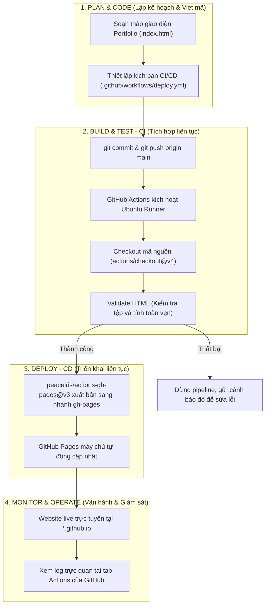

# 📝 BÁO CÁO KẾT QUẢ THỰC HÀNH LAB 1
## Học phần: Vận hành & Bảo trì Phần mềm (DevOps)
### Đề tài: Trải nghiệm DevOps Workflow End-to-End với GitHub Actions & GitHub Pages

---

## 1. THÔNG TIN SINH VIÊN
- **Họ và tên:** Nguyễn Minh Hải
- **Mã số sinh viên (MSSV):** DTC235180061
- **Lớp:** KTPM K22B
- **Email:** dtc235180061@ictu.edu.vn
- **Trường:** Đại học Công nghệ Thông tin và Truyền thông - ĐH Thái Nguyên (ICTU)
- **Ngày thực hiện:** 12/10/2026
- **Kho lưu trữ (Repository):** [https://github.com/Hiravem/devops-lab1-portfolio](https://github.com/Hiravem/devops-lab1-portfolio)
- **Địa chỉ Website Online:** [https://Hiravem.github.io/devops-lab1-portfolio/](https://Hiravem.github.io/devops-lab1-portfolio/)

---

## 2. BƯỚC 4.1: BẢNG SO SÁNH DEVOPS VS TRUYỀN THỐNG (TRADITIONAL)

| Tiêu chí so sánh | Cách THỦ CÔNG (Traditional) | Cách DEVOPS (CI/CD Pipeline) |
| :--- | :--- | :--- |
| **1. Làm sao để deploy?** | Developer nén file mã nguồn, mở phần mềm FTP (FileZilla) hoặc SSH vào server, tải đè file lên thư mục máy chủ, cấu hình lại web server và khởi động lại dịch vụ bằng tay. | Chỉ cần đẩy mã nguồn lên Git (`git push origin main`), GitHub Actions tự động phát hiện thay đổi và kích hoạt toàn bộ quy trình kiểm thử, build và deploy. |
| **2. Mất bao lâu?** | Tốn từ **15 đến 30 phút** (hoặc vài tiếng đối với hệ thống lớn, phải chờ lịch release định kỳ). | Chỉ mất khoảng **10 đến 30 giây** để toàn bộ pipeline hoàn tất và website được cập nhật online. |
| **3. Ai làm deploy?** | Con người trực tiếp thực hiện (Developer, System Admin hoặc Operator). | Hệ thống tự động hóa hoàn toàn (GitHub Actions Runner thực thi theo kịch bản định sẵn). |
| **4. Có bị sai sót không?** | **Rất dễ xảy ra lỗi** do yếu tố con người (*Human Error*): copy thiếu file, copy nhầm thư mục, sai phân quyền, cấu hình môi trường lệch nhau. | **Nhất quán 100%**: Mọi bước đều được định nghĩa rõ ràng trong code (`deploy.yml`), môi trường máy ảo Ubuntu luôn chuẩn hóa và sạch sẽ. |
| **5. Rollback nếu lỗi?** | Phức tạp và căng thẳng: Phải lục tìm file backup cũ, ghi đè lại server hoặc vá lỗi nóng (*hotfix*) trực tiếp trên môi trường Production, dễ gây mất dữ liệu và downtime kéo dài. | Cực kỳ an toàn và tức thì: Chỉ cần hoàn tác commit trên Git (`git revert <commit_id>`) rồi push lên kho, pipeline sẽ tự động deploy lại phiên bản ổn định trước đó. |
| **6. Làm sao biết deploy thành công?** | Phải vào server gõ lệnh kiểm tra log, mở trình duyệt ấn F5 nhiều lần để kiểm tra thủ công. | Hệ thống cung cấp giao diện trực quan với huy hiệu trạng thái (Status badge), thông báo ✅ (Passed) hoặc ❌ (Failed), kèm nhật ký log chi tiết từng giây cho từng công đoạn. |

---

## 3. BƯỚC 4.2: SƠ ĐỒ QUY TRÌNH DEVOPS WORKFLOW ĐÃ TRẢI NGHIỆM

---

## 4. BƯỚC 4.3: TRẢ LỜI CÁC CÂU HỎI NHẬN THỨC

### Câu hỏi 1: DevOps workflow tự động hóa những bước nào mà cách thủ công phải làm bằng tay?
> **Trả lời:**
> Quy trình DevOps đã tự động hóa hoàn toàn các bước:
> 1. **Kiểm tra và xác thực mã nguồn (Continuous Integration):** Tự động kiểm tra file `index.html` có tồn tại hay không, dung lượng file hợp lệ hay không trước khi đưa lên môi trường thật.
> 2. **Đóng gói và vận chuyển (Packaging):** Tự động thu thập các tài nguyên web tĩnh đưa vào môi trường triển khai mà không cần con người nén file zip hay copy file thủ công.
> 3. **Phát hành lên máy chủ (Continuous Deployment):** Tự động đẩy bản build sang nhánh `gh-pages` và kích hoạt dịch vụ lưu trữ GitHub Pages.
> 4. **Ghi nhật ký và cảnh báo:** Tự động tạo bản log chi tiết từng bước, thời gian thực thi và trạng thái thành công/thất bại mà không cần quản trị viên kiểm tra thủ công trên server.

---

### Câu hỏi 2: Nếu bạn deploy sai (website bị lỗi), làm sao để quay lại phiên bản cũ?
> **Trả lời:**
> Nhờ nguyên lý **"Mọi thứ đều là Code" (Infrastructure & Pipeline as Code)** kết hợp chặt chẽ với Git Version Control:
> - Cách 1: Sử dụng lệnh `git revert <commit_bị_lỗi>` để tạo commit đảo ngược trạng thái code về phiên bản an toàn trước đó, sau đó chạy `git push origin main`.
> - Cách 2: Chuyển nhánh hoặc reset về commit trước bằng `git reset --hard <commit_ổn_định>` và force push (nếu làm trên nhánh cá nhân).
> 
> Ngay khi nhận được commit mới, pipeline CI/CD sẽ lập tức chạy lại quy trình tự động và ghi đè phiên bản sửa lỗi lên GitHub Pages chỉ trong khoảng 15 giây mà không làm gián đoạn hệ thống.

---

### Câu hỏi 3: GitHub Actions pipeline đã giúp bạn tiết kiệm bao nhiêu thời gian so với cách thủ công?
> **Trả lời:**
> - **Cách làm thủ công:** Mất khoảng **15 – 30 phút** cho mỗi lần cập nhật (mở công cụ FTP, đăng nhập vào server, tìm đúng đường dẫn thư mục, tải đè file, kiểm tra lỗi trên server, kiểm tra lại trình duyệt, nếu có nhiều người cùng phát triển thì thời gian chờ đợi trao đổi còn lâu hơn).
> - **Cách làm DevOps (GitHub Actions):** Chỉ mất đúng **thao tác gõ `git push`** (khoảng 3 – 5 giây của lập trình viên) và hệ thống máy chủ ảo mất khoảng **10 – 20 giây** để hoàn tất toàn bộ quy trình đưa lên web trực tiếp.
> - **Hiệu quả:** Tiết kiệm hơn **95% thời gian** triển khai, đồng thời loại bỏ 100% rủi ro quên bước, thao tác nhầm hoặc lệch cấu hình giữa các môi trường.

---

## 5. CHECKLIST NỘP BÀI (LAB 1 SUBMISSION CRITERIA)

| STT | Tên file minh chứng | Nội dung yêu cầu chụp | Trạng thái |
| :---: | :--- | :--- | :---: |
| 1 | `screenshots/01-github-repo.png` | Ảnh chụp giao diện Repository `devops-lab1-portfolio` trên GitHub có đầy đủ file | ⬜ Cần chụp |
| 2 | `screenshots/02-pipeline-running.png` | Ảnh chụp tab Actions trên GitHub khi workflow đang thực thi | ⬜ Cần chụp |
| 3 | `screenshots/03-pipeline-success.png` | Ảnh chụp tab Actions khi workflow hoàn thành xuất sắc (tất cả các bước đều có dấu tích xanh ✅) | ⬜ Cần chụp |
| 4 | `screenshots/04-website-online.png` | Ảnh chụp giao diện website Portfolio hiển thị trực tiếp trên trình duyệt từ đường dẫn `*.github.io` | ⬜ Cần chụp |
| 5 | `screenshots/05-update-pipeline.png` | Ảnh chụp pipeline tự động chạy lại sau khi sửa đổi mã nguồn và push commit mới | ⬜ Cần chụp |
| 6 | `screenshots/06-comparison-table.png` | Ảnh chụp bảng so sánh DevOps vs Traditional trong báo cáo này | ⬜ Cần chụp |
| 7 | `ho_ten_mssv.txt` | File text chứa thông tin cá nhân sinh viên | ✅ Đã chuẩn bị |
