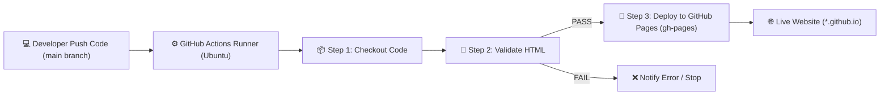

# 🚀 DevOps Lab 1: Portfolio & CI/CD Pipeline với GitHub Actions

Dự án thực hành **Lab 1 — Môn học Vận hành & Bảo trì Phần mềm (DevOps)**: Xây dựng trang web Portfolio cá nhân và thiết lập quy trình tự động hóa kiểm thử, triển khai (CI/CD Pipeline) lên GitHub Pages sử dụng GitHub Actions.

---

## 📌 Thông tin sinh viên
- **Họ và tên:** Nguyễn Minh Hải
- **Mã sinh viên (MSSV):** DTC235180061
- **Lớp:** KTPM K22B
- **Email:** dtc235180061@ictu.edu.vn
- **Trường:** ICTU - Trường Đại học Công nghệ Thông tin và Truyền thông
- **Học phần:** Vận hành & Bảo trì Phần mềm (DevOps)
- **GitHub Repository:** [https://github.com/Hiravem/devops-lab1-portfolio](https://github.com/Hiravem/devops-lab1-portfolio)
- **GitHub Pages Live:** [https://Hiravem.github.io/devops-lab1-portfolio/](https://Hiravem.github.io/devops-lab1-portfolio/)

---

## 🎯 Mục tiêu bài Lab
1. Trải nghiệm thực tế toàn bộ vòng đời **DevOps Lifecycle**: `Plan` → `Code` → `Build` → `Test` → `Deploy` → `Monitor`.
2. Tự tay thiết lập pipeline CI/CD tự động bằng **GitHub Actions** (Workflow file `.github/workflows/deploy.yml`).
3. Triển khai website tự động lên **GitHub Pages** (có URL công khai trên Internet).
4. So sánh sự khác biệt và lợi ích vượt trội của quy trình **DevOps hiện đại** so với cách làm **Thủ công truyền thống**.

---

## 🛠️ Công nghệ sử dụng
- **Frontend:** HTML5, CSS3 hiện đại, Vanilla JavaScript (responsive trên máy tính và điện thoại).
- **Version Control:** Git, GitHub.
- **CI/CD Platform:** GitHub Actions (Ubuntu Runner, `actions/checkout@v4`, `peaceiris/actions-gh-pages@v3`).
- **Hosting / Deployment:** GitHub Pages (`gh-pages` branch).

---

## 📁 Cấu trúc thư mục
```
devops-lab1-portfolio/
├── .github/
│   └── workflows/
│       └── deploy.yml        # CI/CD Pipeline định nghĩa trên GitHub Actions
├── index.html                # Mã nguồn trang web Portfolio cá nhân
├── README.md                 # Tài liệu giới thiệu dự án
├── BAOCAO_LAB1.md            # Báo cáo chi tiết kết quả thực hành & câu hỏi Lab 1
├── ho_ten_mssv.txt           # Thông tin sinh viên nộp bài
├── scripts/
│   ├── verify.ps1            # Script tự động kiểm tra trên Windows PowerShell
│   └── verify.sh             # Script kiểm tra môi trường trên Linux / Bash
└── screenshots/              # Thư mục lưu ảnh minh chứng kết quả để nộp bài
    ├── 01-github-repo.png
    ├── 02-pipeline-running.png
    ├── 03-pipeline-success.png
    ├── 04-website-online.png
    ├── 05-update-pipeline.png
    └── 06-comparison-table.png
```

---

## 🔄 Quy trình CI/CD Pipeline (Workflow)



### Các bước trong Pipeline (`deploy.yml`):
1. **Trigger:** Pipeline tự động kích hoạt khi có commit đẩy lên nhánh `main` hoặc kích hoạt thủ công qua nút bấm `workflow_dispatch`.
2. **Checkout Code:** Sử dụng `actions/checkout@v4` để tải mã nguồn dự án vào máy ảo runner.
3. **Validate HTML:** Kiểm tra sự tồn tại của file `index.html` và đo đạc kích thước file, đảm bảo web đủ điều kiện phát hành.
4. **Deploy to GitHub Pages:** Sử dụng action `peaceiris/actions-gh-pages@v3` để đóng gói và push sang nhánh `gh-pages` để GitHub Pages tự động phát hành website online.

---

## 💻 Hướng dẫn chạy thử nghiệm Local

1. Mở file `index.html` trực tiếp trên trình duyệt:
   ```powershell
   # Windows PowerShell
   Start-Process index.html
   ```
2. Chạy script kiểm tra chuẩn bị trước khi push:
   ```powershell
   # Chạy script PowerShell
   .\scripts\verify.ps1
   ```

---

## 🚀 Hướng dẫn đẩy lên GitHub & kích hoạt Pages

1. Tạo repository mới trên GitHub với tên: `devops-lab1-portfolio` (chế độ **Public**).
2. Thêm remote origin và push mã nguồn:
   ```bash
   git remote add origin https://github.com/Hiravem/devops-lab1-portfolio.git
   git branch -M main
   git push -u origin main
   ```
3. Bật GitHub Pages:
   - Truy cập **Settings** → **Pages** trên repository GitHub.
   - Tại mục **Build and deployment** / **Branch**: Chọn nhánh `gh-pages` → `/ (root)` → nhấn **Save**.
   - Website sẽ có địa chỉ: `https://Hiravem.github.io/devops-lab1-portfolio/`
